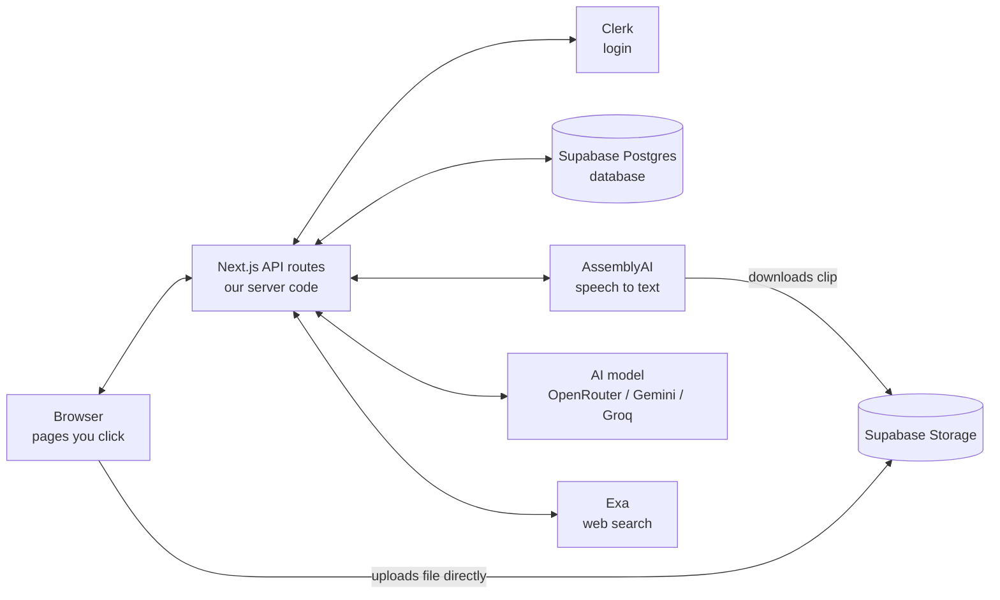

# Fura — How It Works

> **Fura learns how a content creator talks from their own videos, then writes new scripts, hooks and video ideas that sound like them.**

This document explains the idea, the design and every part of the code in plain language.
The website has the same tour as an interactive page at **`/how-it-works`**: click a step and it shows the real code for it.

---

## 1. The problem

Creators who post often (YouTube, Instagram Reels, TikTok) spend hours writing scripts.
General AI tools like ChatGPT can write scripts, but the result sounds like ChatGPT, not like the creator.
Viewers notice, and the creator has to rewrite everything.

## 2. The idea

Instead of describing your style to an AI, **let the AI listen to you**.

1. You upload a few clips of yourself talking.
2. Fura turns the speech into text and studies it: your tone, pace, how you open videos, the phrases you repeat.
3. It saves this as your **Creator DNA**, a short profile of your voice.
4. Every time you ask for a script, Fura gives the AI your Creator DNA first, including real sentences you said, so the new script copies your rhythm and vocabulary.

---

## 3. What a user does (the user journey)

| Step | What the user sees | What happens behind the scenes |
|---|---|---|
| 1 | Signs up | Clerk creates the account. |
| 2 | "Tell Fura about you": niche, platforms, goals, audience | Saved to the database (`/api/profile`). |
| 3 | Uploads 3–10 clips | Each file goes straight from the browser to Supabase Storage, then AssemblyAI starts transcribing it. |
| 4 | "Learning your voice" progress screen | The page asks the server every 4 seconds. When all clips are transcribed, the AI builds the Creator DNA. |
| 5 | Dashboard shows "Your voice" | The Creator DNA: summary, tone, catchphrases, dos and don'ts, real example lines. |
| 6 | Studio: picks Script / Hooks / Ideas, types a topic | The AI writes using the Creator DNA (and optional web research). Result is saved. |
| 7 | Library | Every past result, to copy or delete. |

---

## 4. The big picture (architecture)



**In words:** the browser shows pages. Whenever it needs data, it calls our own server routes (`/api/...`).
Those routes check who you are, read/write the database, and call outside services.
Big files skip our server completely and go straight to storage.

### Why this design?

| Choice | Why |
|---|---|
| **One Next.js app** (pages + server in one project) | The old version had a separate backend server on Railway, which cost money and was shut down. Now everything deploys to **Vercel's free plan** as one project. |
| **Browser uploads directly to storage** | Free hosting limits how big a request can be (about 4.5 MB) and how long it can run. Video files are bigger than that, so they must not pass through our server. |
| **Short "polling" calls instead of one long call** | Transcribing can take a minute or more. Free hosting stops functions after a time limit, so the page asks "is it done yet?" every 4 seconds instead. |
| **Standard "OpenAI chat" format for AI** | The same code works with OpenRouter (Claude, GPT…), Google Gemini or Groq. Switching provider or model = changing `AI_BASE_URL`, `AI_API_KEY`, `AI_MODEL` in `.env.local`. |
| **Clerk for login** | Building secure login (passwords, email checks, sessions) ourselves is risky. Clerk does it for us. |
| **Plain functions, no classes** | Easier to read and explain. Each file does one job. |

---

## 5. Tech stack

| Part | Tool | Job |
|---|---|---|
| Framework | **Next.js 14** (React) + TypeScript | Pages and server routes in one project |
| Styling | **Tailwind CSS** | Styles written as class names; colours in `app/globals.css` |
| Login | **Clerk** | Sign up, sign in, sessions |
| Database | **Supabase** (Postgres) | Stores users, clips, transcripts and results |
| File storage | **Supabase Storage** | Holds the uploaded clips |
| Speech to text | **AssemblyAI** | Transcribes clips, finds repeated phrases |
| AI writing | **OpenRouter / Gemini / Groq** | Sends prompts to the chosen AI model |
| Web research | **Exa** (optional) | Finds real facts for scripts |
| Hosting | **Vercel** (free) | Runs the whole app |

---

## 6. Folder map

```
fura/
├── app/                          ← every page and every server route
│   ├── page.tsx                  ← home page (fura.dev)
│   ├── layout.tsx                ← wraps every page: fonts + Clerk login provider
│   ├── globals.css               ← colours (light + dark) and shared styles
│   ├── sign-in/, sign-up/        ← Clerk's login forms
│   ├── onboarding/page.tsx       ← 3-step setup
│   ├── dashboard/
│   │   ├── layout.tsx            ← sidebar / top bar
│   │   ├── page.tsx              ← "Your voice" (Creator DNA) + recent work
│   │   ├── studio/page.tsx       ← write scripts, hooks, ideas
│   │   └── library/page.tsx      ← everything generated
│   ├── how-it-works/             ← the interactive code tour
│   └── api/                      ← SERVER CODE (runs on Vercel, never in the browser)
│       ├── me/route.ts           ← dashboard data
│       ├── profile/route.ts      ← save "about you"
│       ├── clips/route.ts        ← upload link + list clips
│       ├── clips/transcribe/     ← start transcription
│       ├── dna/route.ts          ← check transcripts, build Creator DNA
│       ├── generate/route.ts     ← write script / hooks / ideas
│       └── creations/route.ts    ← library list + delete
├── lib/                          ← small helpers used by the routes
│   ├── route.ts                  ← login check + error handling for every route
│   ├── db.ts                     ← database connection, credits
│   ├── ai.ts                     ← talk to the AI model
│   ├── transcribe.ts             ← talk to AssemblyAI
│   ├── research.ts               ← talk to Exa
│   ├── prompts.ts                ← EVERY instruction given to the AI
│   ├── outputs.ts                ← checks and cleans what the AI sends back
│   ├── client.ts                 ← browser helper to call our API
│   └── labels.ts                 ← small display helpers
├── components/                   ← reusable UI pieces (logo, copy button, markdown)
├── middleware.ts                 ← blocks dashboard pages if not signed in
├── supabase/schema.sql           ← database tables (already in your Supabase)
└── samples/                      ← 3 demo clips for testing
```

**Rule of thumb:** anything in `app/api/` or `lib/` (except `client.ts`) runs on the server and can use secret keys.
Everything with `"use client"` at the top runs in the browser and never sees secret keys.

---

## 7. Step by step through the code

### Step 1 — Login (`middleware.ts`, `lib/route.ts`)
- `middleware.ts` runs before every page. If you open `/dashboard` or `/onboarding` without being signed in, Clerk sends you to `/sign-in`.
- Every API route is wrapped in `handler()` from `lib/route.ts`. It:
  1. asks Clerk for the user id (`auth()`),
  2. loads or creates that person's row in the `users` table, using their real email from Clerk, then loads their profile, voice and credits into one simple object (`getCreator()` in `lib/db.ts`),
  3. catches any error and returns `{ error: "message" }` so the page can show it.

### Step 2 — About you (`app/api/profile/route.ts`)
Saves niche, platforms, goals (picked from chips, each with optional context typed into a pop-up) and audience (age groups, a men / women / other-genders mix, and a free description). Every value is forced to the right type and length-limited, because data from a browser can't be trusted. The two text columns hold these as small JSON strings; `audienceText()` and `goalsText()` in `lib/prompts.ts` turn them back into plain sentences for the AI.

### Step 3 — Uploading clips (`app/api/clips/route.ts`, `app/onboarding/page.tsx`)
1. The browser tells our server the file's name, type and size.
2. The server checks it's audio/video and under 50 MB, then asks Supabase for a **one-time upload link** (`createSignedUploadUrl`) and records the clip in `videos` with status `uploading`.
3. The browser sends the file straight to that link (`putFile()` in the onboarding page), showing a real progress bar.
4. The browser calls `/api/clips/transcribe`. The server makes a **private download link** for the file and gives it to AssemblyAI (`startTranscription()` in `lib/transcribe.ts`). Status becomes `transcribing`.

### Step 4 — Waiting for transcripts (`app/api/dna/route.ts`, part 1)
The progress screen calls `POST /api/dna` every 4 seconds. Each call asks AssemblyAI about every clip still `transcribing` (`checkTranscription()`):
- finished → save the text in `transcripts`, status `done`
- error, or no speech in the clip → status `failed`

### Step 5 — Building the Creator DNA (`app/api/dna/route.ts`, part 2–3, `lib/prompts.ts`)
When no clip is still being worked on and at least one is `done`:
1. **Claim the job**: set the voice status to `building` only if it isn't already (`claimVoiceBuild()`). This stops two open tabs from paying for the same AI call twice.
2. Send the transcripts (newest 10 clips) to the AI with the `DNA_SYSTEM` instructions. The AI must answer in JSON with: summary, tone, pacing, hookStyle, structure, audienceRelationship, catchphrases, favoriteWords, topics, dos, donts, **sampleLines** (real sentences copied from the transcripts).
3. Save it in `style_profiles.profile_json` as `{ status: "ready", dna: {...} }`. The page sends you to the dashboard.

### Step 6 — Writing (`app/api/generate/route.ts`)
The route follows four numbered steps (they are numbered in the code too):
1. **Check** the request: valid kind, topic present, voice ready, enough credits. Then **take the credits** right away (`chargeCredits` in `lib/db.ts`), so several requests at once can't go over 100. If anything below fails, the credits are given back.
2. **Research** (scripts only, optional): search the web with Exa.
3. **Ask the AI**: pick `scriptPrompt`, `hooksPrompt` or `ideasPrompt` from `lib/prompts.ts`. The AI must reply in JSON.
   `lib/outputs.ts` checks that JSON (a script needs a Hook and an Outro, hooks need 7 different lines, ideas need 10),
   cleans the text (no em dashes, no stray quotes) and, if the answer is broken, asks the AI once more with the exact problem.
   If the topic is unsafe, the AI answers `{"refused": "..."}` and the person sees that friendly message instead.
4. **Save** to the `generations` table as Markdown (`toMarkdown`), so the Library can show it. The Studio gets the JSON too, and shows hooks and ideas as cards and the script section by section.

### Step 7 — Why it sounds like you (`voiceCard()` in `lib/prompts.ts`)
Every writing prompt begins with a "voice card" built from the Creator DNA:
- the summary, tone, pacing, how they open and structure videos,
- catchphrases and favourite words,
- dos and don'ts,
- **real lines the creator said**. This is the most powerful part: models copy style best from real examples ("few-shot prompting").
- a list of banned AI clichés ("Let's dive in", "game-changer"…).

### Step 8 — Credits (`lib/db.ts`)
Everyone gets 100 credits a month (script = 2, hooks = 1, ideas = 1).
The `usage` table has one row per person per month (like `"2026-11"`). A new month has no row yet, so usage starts at 0 by itself, with no scheduled job needed.

---

## 8. Database (`supabase/schema.sql`)

Seven small tables and one storage bucket:

| Table | One row per… | What it holds |
|---|---|---|
| `users` | person | `clerk_id` (link to the login), email, name |
| `niche_profiles` | person | "About you": niche, platforms, audience, goals |
| `style_profiles` | person | The Creator DNA: `profile_json = { status, dna }` |
| `usage` | person per month | credits used that month |
| `videos` | uploaded clip | file location, AssemblyAI job id, status |
| `transcripts` | clip | the text of the clip |
| `generations` | generated result | `type` (script/hooks/ideas), topic, the Markdown output |

**Security:** Row Level Security is on with no public rules, so nobody can read the tables from a browser.
Only our server, using the secret service key, can read and write them. Every query also filters by the signed-in person's id, so one user can never see another user's data.
The `clips` storage bucket is private, and only accepts audio/video files up to 50 MB.

---

## 9. Statuses (small state machines)

```
clip.status:       uploading → transcribing → done
                                           ↘ failed

voice status:       none → building → ready
                               ↘ failed  (user presses "Try again")
            (uploading a new clip sets it back to none, so the DNA is rebuilt)
```

---

## 10. Running it

```bash
npm install
cp .env.example .env.local     # then fill in the keys
npm run dev                    # open http://localhost:3000
```

The database tables already exist in the Supabase project. For a brand-new project, paste `supabase/schema.sql` into Supabase → **SQL Editor** → **Run**.

### Hosting it for free

| Piece | Free service | Free limits that matter |
|---|---|---|
| Website **and** server code | **Vercel** (Hobby plan) | Personal/non-commercial use; each API call can run up to 60 s |
| Database + file storage | **Supabase** (Free plan) | 500 MB database, 1 GB files, 50 MB per file; project pauses after 7 days with no activity |
| Login | **Clerk** (Free) | 10,000 monthly users |
| Speech to text | **AssemblyAI** | Free credit on sign-up, then pay per hour of audio |
| AI writing | **Google Gemini** or **Groq** free tier, or OpenRouter `:free` models | Rate limits per minute/day |

Steps: push the code to GitHub → on vercel.com click **Add New → Project** → pick the repo → paste the environment variables from `.env.local` → **Deploy**. Then in Clerk, add the Vercel address (or fura.dev) to the allowed domains.

To change the AI, set `AI_BASE_URL`, `AI_API_KEY` and `AI_MODEL` in `.env.local` (examples are in `.env.example`). `AI_MODEL` can list backup models separated by commas: if one fails or takes over 60 seconds, `lib/ai.ts` tries the next.

---

## 11. Limits and what could come next

- **Credit race:** if two generations finish at the exact same moment, credits are counted once. Fine for now; a database function would fix it at scale.
- **Stuck build:** if the server is stopped mid-way while building the DNA, the status stays `building`. Uploading a new clip resets it.
- **50 MB per file** (Supabase free plan). Longer videos should be compressed or exported as audio.
- **Next ideas:** paste a YouTube link instead of uploading; payments for more credits; rewrite/edit a script with follow-up instructions; per-platform formatting.

---

## 12. Words used in this project

| Word | Meaning |
|---|---|
| **Creator DNA** | Fura's saved profile of how a creator talks. |
| **API route** | A server function the browser can call, like `/api/generate`. |
| **Transcription** | Turning speech in a clip into text. |
| **Prompt** | The instructions and information we send to the AI. |
| **Few-shot prompting** | Showing the AI real examples so it copies their style. |
| **Signed URL** | A temporary, secret link to upload or download one file. |
| **Polling** | Asking "is it done yet?" again and again on a timer. |
| **Row Level Security** | A database setting that blocks access unless a rule allows it. |
| **Serverless** | Code that runs only when called, on someone else's servers (Vercel). |
